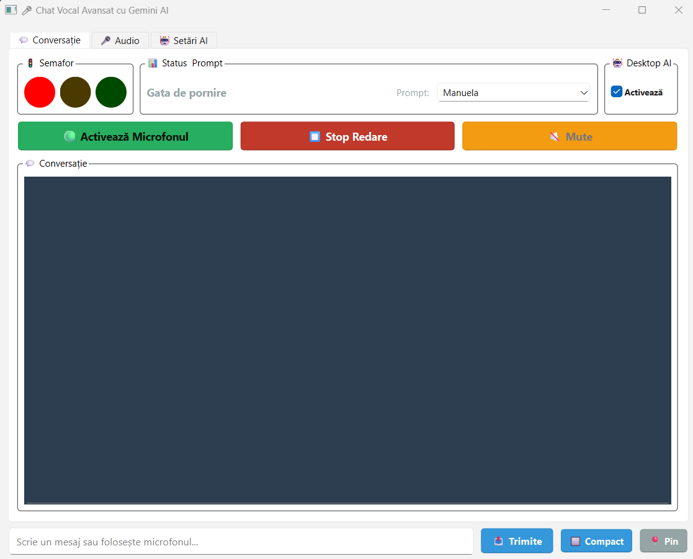

# 🎤 Desktop Voice Assistant

**Talk to Gemini about whatever is on your screen.** A desktop assistant that listens continuously, answers out loud in a natural voice and, when the question needs it, looks at your screen: *"what does this error mean?"*, *"which move should I play here?"*, *"where do I click to change this setting?"*.



**Tech:** Python · PySide6 · Google Gemini (multimodal, streaming) · Silero VAD · Google Speech Recognition · Edge TTS · PyTorch

---

## ✨ Features

### 🗣️ A real conversation
- **Hands-free listening:** neural voice activity detection (Silero VAD) knows when you start and stop speaking; no push-to-talk.
- **Automatic calibration** to the room's background noise, plus manual threshold, pause length and maximum phrase length.
- **Streaming answers:** Gemini's reply is spoken sentence by sentence while the rest is still being generated, so it starts talking almost immediately.
- Optional **echo cancellation**, so the assistant does not hear itself.
- A traffic-light indicator shows whether it is listening, thinking or speaking; **Stop** and **Mute** at any time; type instead of speaking whenever you like.
- Configurable conversation memory (how many previous turns it remembers).

### 👁️ It sees your screen, only when it matters
- In **Desktop AI** mode, every question is sent together with a screenshot of your screen.
- The system prompt tells the model to **ignore the image unless the question needs it**: *"what's the capital of France?"* gets a normal answer, while *"what does this error mean?"* gets an answer about what is on screen.
- Screenshots are sent **from memory and never written to disk** (unless you explicitly turn on debug saving).

### 🎭 Personalities
- Several system prompts (personalities) kept as editable text files; switch between them from a drop-down, and the conversation context resets.
- Create, edit and delete them from the app.
- Choice of Gemini model (Flash for speed, Pro for depth) and of voice.

### 🪟 Stays out of the way
- **Compact mode**, a small window you can keep in a corner.
- **Pin** keeps it always on top of other windows.

---

## 🔒 Your data stays local

```
<root>/
├── Project/   this repository (code + default prompt)
└── Data/      voice_chat_config.json, prompts/ (yours), .env, temp/, logs/
```

- On first start your personal `prompts/` folder is created from the default one.
- **What leaves your computer:** your voice is transcribed by Google Speech Recognition; your message (and, in Desktop AI mode, the screenshot) goes to Google Gemini; the text to be spoken goes to Microsoft Edge TTS. Turn Desktop AI off when you have something private on screen.
- Debug screenshots are saved only with `VOICECHAT_SAVE_SCREENSHOTS=1`, and then only into `Data/screenshots/` (emptied at every start).
- `VOICECHAT_DATA_DIR` moves the data folder anywhere.

---

## 🚀 Getting started

Windows 10/11 (screen capture uses Pillow's `ImageGrab`), Python 3.10+, a microphone.

```bash
git clone https://github.com/mmereu97/desktop-voice-assistant.git Project
cd Project
pip install -r requirements.txt
```

Create `../Data/.env` with your Gemini API key:
```ini
GOOGLE_API_KEY=your-key
```

Then:
```bash
python voice_chat.py
```

Windows executable: `pip install pyinstaller` and `pyinstaller voice_chat.spec` (the `Data` folder is then created next to the `.exe`).

The interface and the default personality are in Romanian.

---

## 👤 Author

Mihai Mereu · [GitHub](https://github.com/mmereu97)
